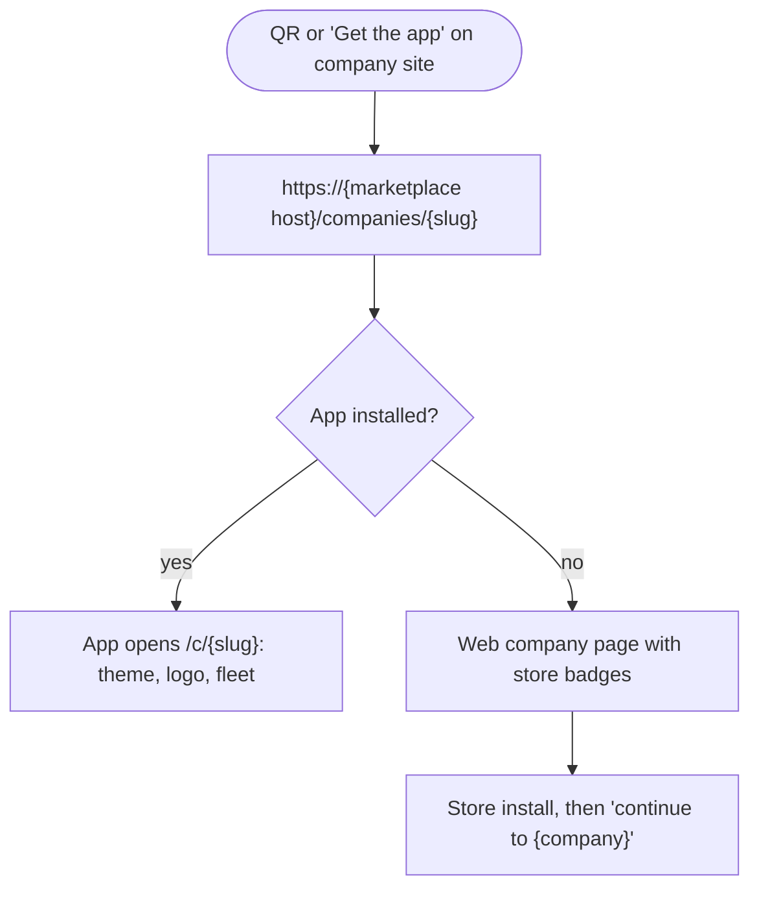

# Benwer Cars guest app plan

Plan for one shared Benwer Cars guest app (Option B): browse the marketplace, see trips across all companies, and switch into a company-branded mode from a deep link or QR. Built as a much smaller copy of the admin mobile app. Plan only: no code, PRs, tests or setting changes yet.

## Contents

1. [Goals and v1 scope](#goals-and-v1-scope)
2. [Rules this plan follows](#rules-this-plan-follows)
3. [What exists today](#what-exists-today)
4. [Admin mobile patterns: copy or drop](#admin-mobile-patterns-copy-or-drop)
5. [App architecture](#app-architecture)
6. [Company mode](#company-mode)
7. [API changes (benwer-cars-api)](#api-changes-benwer-cars-api)
8. [Marketplace and admin changes](#marketplace-and-admin-changes)
9. [Firebase, Apple and Play setup](#firebase-apple-and-play-setup)
10. [CI, tests and release flow](#ci-tests-and-release-flow)
11. [Milestones](#milestones)
12. [Open decisions for Rafael](#open-decisions-for-rafael)
13. [Unverified and risks](#unverified-and-risks)

---

## Goals and v1 scope

> **Decision:** One app, "Benwer Cars", for every guest. A guest signs in once and sees bookings from every company. Opening a company link or QR puts the app into that company's branding and fleet, with a switcher back to the marketplace. Apple's guideline 4.2.6 names this single-app "picker" model as the accepted alternative to cloned white-label apps.

### In v1

- Sign-in with email/password, Google and Apple (Apple required by guideline 4.8)
- My trips across all companies: upcoming and past
- Trip detail: status, car, dates, price, pay (Stripe PaymentSheet), cancel and withdraw via the existing token endpoints
- Browse the marketplace: companies, cross-company car search, car detail
- Company mode from deep link or QR, with a company switcher
- Push notifications for booking status changes
- Full account deletion in the app (guideline 5.1.1(v))
- Languages en-GB, es-ES, pt-PT; light and dark

### Out of scope for v1

- Native booking checkout (v1 hands off to the company booking site; native in phase 3)
- Per-company white-label store listings
- Pre-check-in, document upload and contract signing in the app (they open the existing web links)
- Reviews written in the app, chat, loyalty, offline mode
- Maps view of companies (list first)
- Tablet layouts, web build as a product (Expo web stays for E2E only)

## Rules this plan follows

- Every Benwer change covers mobile: the API changes ship together with the guest app, and the admin mobile booking-request badge (see below).
- Staging first: API and marketplace to staging, guest app staging build to the `.staging` package, production only after Rafael approves.
- Tests run only after Rafael approves them for staging.
- CI on GitHub-hosted runners only (no Blacksmith). The admin mobile CI uses the self-hosted PC runners; the guest repo will not, and the PC runners are not touched.
- Infra stays in Europe: Sentry de.sentry.io, Mixpanel EU endpoint, API on Railway EU, Vercel functions in an EU region.
- Sentry, Mixpanel and Expo stay on free plans.
- Stripe stays sandbox/test on staging. No secrets in repos, docs or this page.
- Production Play releases never go out without Rafael's explicit approval; staging builds never go to production packages and production builds never go to staging packages.

## What exists today

| Area | Details | Status |
| --- | --- | --- |
| Shared guest identity | One guest Firebase project. API tables `guest_accounts`, `guest_company_links` (one customer per company), `guest_link_challenges`. Auto-link when the verified email equals a customer email. | ✅ Ready |
| Guest endpoints, per company | `/v1/public/companies/{slug}/guest/me`, `reservations`, `link`, `link/confirm`, erase. No cross-company list yet. | ⚠️ Partial |
| Booking, pay, cancel by token | Public booking endpoint (optional guest bearer) and token endpoints for payment, cancellation quote, cancel, withdraw, review. Payment returns `clientSecret`, `publishableKey` and `connectedAccountId`. | ✅ Ready |
| Company branding | `GET /v1/public/sites/{slug}`: `brandColor`, `fontFamily`, `cornerStyle`, logos (light and dark), banners, contact, legal. | ✅ Ready |
| Booking emails | Status link is `{marketplaceUrl}/booking/{token}`, so marketplace-host universal links open the app with no email change. | ✅ Ready |
| Push for guests | `device_tokens` and web push link only to staff users and send through the staff Firebase project. | ❌ Missing |
| Full account delete | Only per-company erase; the shared guest identity is kept on purpose. | ❌ Missing |

## Admin mobile patterns: copy or drop

Read from `benwerhq/benwer-cars-admin-mobile`, staging branch (commit `b2e04b7`).

| Area | Admin mobile today | Guest app |
| --- | --- | --- |
| Stack | Expo 58, RN 0.88, expo-router, TS strict, TanStack Query, react-hook-form, zod | Copy as is (same versions) |
| Folders | `src/app`, `components/{ui,layout,…}`, `hooks`, `services/api`, `context`, `lib`, `enums`, `types`, `theme`, `i18n` | Copy layout; about 10 of 60+ component folders |
| Routes | `(app)/(tabs)` with 4 tabs, Account stack, Platform, Support | `(tabs)` Explore, Trips, Account + `c/[slug]` company stack; no gate on Explore |
| Data flow | Screen → hook → service → openapi-fetch client; `generate:api` from `openapi/admin-v1` | Copy; generate from the API's public OpenAPI (public + guest tags) |
| Auth | `AuthContext` (448 lines): RN Firebase auth, Google Sign-In, `POST /auth/firebase` exchange, SecureStore profile, MFA, impersonation | Smaller `GuestAuthContext`: RN Firebase (guest project) + Google + Apple; no exchange, no MFA, no impersonation; bearer = Firebase ID token |
| 401 handling | `session-expiry.ts`: one forced token refresh, then sign out | Copy |
| Google callback | `+native-intent.ts` ignores the OAuth redirect | Copy, plus https universal-link mapping |
| Theming | `theme/tokens.ts` semantic tokens, `ThemeContext` with accents + light/dark in AsyncStorage | Copy; add runtime company accent from `brandColor` |
| i18n | i18next, ICU JSON en-GB/es-ES/pt-PT, `check-i18n` scripts | Copy; namespaces `common` + `guest` |
| Feature flags | `company-features.ts` (per-company settings), `product-flags.ts` | Drop staff flags; respect API visibility (`marketplace` / `bookingWebsite`) only |
| Push | `usePushRegistration`, `lib/push.ts`, RN Firebase messaging, `PUT /v1/devices/push-token`, tap → `/notifications` | Copy, point to `/v1/public/guest/devices/push-token`, tap → trip detail |
| Env | `lib/env.ts` parses `EXPO_PUBLIC_*` (API URL, Firebase, Google client IDs, Sentry, Mixpanel) | Copy; add Apple and marketplace host vars |
| app.config.js | `APP_ENV` flavours, staging package suffix, `firebase/<env>` files, Sentry plugin, FCM channel fix | Copy almost verbatim with guest names |
| EAS | Profiles `alpha-staging` (staging API) and `production`; remote versionCode; local credentials | Copy; add iOS profiles |
| Builds | `eas build --local` inside WSL; `.aab` uploaded by hand to Play | Same for Android; iOS needs EAS cloud (free quota) or a Mac |
| CI | `ci.yml` (audit, lint, typecheck, vitest), `e2e.yml` (Playwright on Expo web + API + Auth emulator), on self-hosted PC runners | Same jobs on `ubuntu-latest` GitHub-hosted runners |
| Sentry | `@sentry/react-native`, de.sentry.io, org `benwerhq`, logger + error boundary | Copy; new project `benwer-cars-guest-mobile` (free plan) |
| Mixpanel | No SDK; POST to api-eu.mixpanel.com with `ip=0`, sanitised props | Copy; guest event list, no PII |
| Drop entirely | Payments terminal, tap-to-pay, contracts, document scan, vehicle condition, reports, platform, settings CRUD, realtime sync, charts | Not needed |

## App architecture

### Proposed folder tree

```text
benwer-cars-guest-mobile/          (new repo, name to confirm)
  app.json / app.config.js         APP_ENV=staging|production flavours (copied pattern)
  eas.json                         alpha-staging / production profiles (copied pattern)
  firebase/<env>/                  gitignored native Firebase files (guest projects)
  openapi/public-v1.json           public + guest contract exported from benwer-cars-api
  messages/{en-GB,es-ES,pt-PT}/    common.json + guest.json (ICU, same checker scripts)
  scripts/                         check-i18n*.mjs, wsl-eas-local-android.sh (copied)
  e2e/                             Playwright on Expo web + Firebase Auth emulator (copied, smaller)
  docs/                            architecture, MOBILE_RELEASE, env, testing (trimmed copies)
  src/
    app/                           expo-router routes (see route tree)
    components/
      ui/                          copy: Button, TextField, Screen, EmptyState, ErrorState,
                                   PageHeader, StatusBadge, StickyFooter, AppErrorBoundary,
                                   KeyboardAwareScrollView, DateField, PhoneInput, Overlays
      auth/                        sign-in form, Google + Apple buttons
      explore/                     search bar, car card, company card, filters
      company/                     company header, switcher sheet, fleet grid
      trips/                       trip card, trip timeline, pay sheet, cancel sheet
      layout/                      AppTopBar (company chip), banners
    context/                       AuthContext (guest), ThemeContext (+ company accent),
                                   QueryProvider, CompanyModeContext (new)
    hooks/                         useMarketplace, useCompanySite, useTrips, useTrip,
                                   useGuestProfile, usePushRegistration, useCompanyMode
    services/api/                  http-client.ts (openapi-fetch), public.ts, guest.ts,
                                   payments.ts, devices.ts, generated/schema.ts
    lib/                           env, logger, sentry, analytics (Mixpanel EU), push,
                                   session-expiry, api-error, deep-links, company-theme,
                                   firebase-auth, native-firebase-auth, google-auth, apple-auth
    i18n/  theme/  enums/  types/  test/
```

### Proposed route tree

```text
src/app/
  _layout.tsx                 Sentry > I18n > Theme > Query > GuestAuth > CompanyMode > Stack
  +native-intent.ts           ignore Google OAuth callback (copied) + map https links:
                                /booking/{token}        -> /trip/token/{token}
                                /companies/{slug}       -> /c/{slug}
                                /companies/{slug}/cars/{id} -> /c/{slug}/cars/{id}
  index.tsx                   redirect -> /(tabs)/explore (or /c/{slug} if company mode saved)
  sign-in.tsx                 email/password, Google, Apple
  sign-up.tsx
  forgot-password.tsx
  verify-email.tsx
  (tabs)/
    _layout.tsx               3 tabs: Explore, Trips, Account (floating tab bar copied)
    explore/index.tsx         marketplace home + search (public, no sign-in)
    explore/cars.tsx          cross-company search results
    explore/companies.tsx     company list (map later)
    trips/index.tsx           auth-gated: Upcoming / Past across all companies
    trips/[id].tsx            trip detail: status, car, dates, price, pay, cancel, contact
    account/index.tsx         profile, linked companies, language, appearance, sign out
    account/profile.tsx
    account/companies.tsx     linked companies + unlink
    account/delete.tsx        full account deletion (store requirement)
  c/[slug]/
    _layout.tsx               company mode: loads GET /v1/public/sites/{slug}, applies theme
    index.tsx                 company home: hero, fleet, contact
    cars/[id].tsx             car detail + availability + Book
    book.tsx                  v1: web handoff; phase 3: native booking
  trip/token/[token].tsx      opened from email link; shows booking, offers sign-in to save it
```

Explore and company pages are public. Trips and Account ask the guest to sign in, and return them where they were after sign-in. That matches guideline 5.1.1(v): no login for features that do not need one.

## Company mode

### Link flow



### Design

| Topic | Design |
| --- | --- |
| Link domain | The marketplace host, which Benwer already owns. Booking emails already link to `{marketplaceUrl}/booking/{token}`, and `/companies/{slug}` already exists as a web page, so every link still works when the app is not installed. |
| Custom domains | They are not added to the app. A company site's App section, footer badge and QR always point to `https://{marketplace host}/companies/{slug}`. Universal links fire when the guest taps a link coming from another domain, so this works from any custom domain or `{slug}.benwer.es`. |
| After install | There is no deferred deep linking in v1. First launch shows "Recently viewed companies" from a one-time code on the web page (optional), or the guest scans the QR again. Mark as a nice-to-have. |
| Theme | `c/[slug]/_layout` loads `GET /v1/public/sites/{slug}` (React Query, cached). `brandColor` becomes the accent in `ThemeContext`; foreground colour is picked by contrast; dark logo used in dark mode. `fontFamily` and `cornerStyle` are ignored in v1, using the app font. |
| What changes in company mode | Explore tab becomes the company home (fleet, contact, WhatsApp). Trips shows this company first with an "All trips" toggle. Benwer marketplace UI is hidden. |
| Switcher | Company chip in AppTopBar opens a sheet: "Benwer marketplace", linked companies (from `GET /guest/me`) and recently opened companies. The choice is saved in AsyncStorage (same pattern as the admin request-scope). |
| Visibility | Company mode only when the company's booking site is published (`bookingWebsite` flag). Marketplace listing only when the `marketplace` flag is on. The API decides; the app shows a "not available" state otherwise. |

## API changes (benwer-cars-api)

### Suggested contracts

```text
# All under /v1/public/guest, guest Firebase bearer (GuestGuard), staff tokens rejected.

GET  /v1/public/guest/me
  200 { id, email, emailVerified,
        companies: [{ slug, name, logoUrl, brandColor, linkedAt }] }

GET  /v1/public/guest/reservations?scope=upcoming|past&cursor=&limit=
  200 { items: [GuestReservation & {
          company: { slug, name, logoUrl, brandColor, phone, whatsapp } }],
        page: { nextCursor } }
  # GuestReservation already carries token + companySlug (API #403),
  # so the app reuses the token endpoints for pay / cancel.

GET  /v1/public/guest/reservations/{id}
  200 GuestReservation & { company }      404 guest.reservation_not_found

POST /v1/public/guest/claim            { bookingToken }
  202 { sent: true }                     # same email-confirm rule as /companies/:slug/guest/link

PUT    /v1/public/guest/devices/push-token   { token, platform: ios|android, locale }
  204
DELETE /v1/public/guest/devices/push-token   { token }
  204

DELETE /v1/public/guest/me
  204                                    # erased at every company + Firebase user deleted
  409 guest.erasure_blocked { companies: [{ slug, name, reason }] }
                                         # e.g. active rental or open balance

# Existing endpoints the app uses unchanged:
GET  /v1/public/companies, /v1/public/vehicles, /v1/public/sites/{slug}
GET  /v1/public/companies/{slug}/vehicles[/{id}], /availability, /price-quote, /extras
POST /v1/public/companies/{slug}/reservations    (guest bearer optional, auto-links)
GET  /v1/public/reservations/{token}
GET|POST /v1/public/reservations/{token}/payments   (clientSecret, publishableKey,
                                                    connectedAccountId -> PaymentSheet)
GET  /v1/public/reservations/{token}/cancellation-quote
POST /v1/public/reservations/{token}/cancel | /withdraw | /review
/v1/public/companies/{slug}/guest/*   (per-company me, link, erase: kept as is)
```

### Guest push

- New table `guest_device_tokens` (`guest_account_id` FK cascade, `fcm_token` unique, `platform` ios|android, `locale`, timestamps). It mirrors `device_tokens` but is not tied to staff users.
- Send through a messaging client on `GuestFirebaseService` (guest project). FCM tokens are scoped per project, so the staff sender cannot reach guest devices.
- Triggers: booking request accepted or declined, booking confirmed, payment due or failed, cancelled by company, pickup reminder the day before, pre-check-in link ready. Hook them where guest emails are sent today.
- Push copy in the guest's locale; no personal data in the payload, only `reservationId` and `companySlug` for navigation.
- Remove tokens on sign-out, on account delete, and on FCM "unregistered" responses.

### Account deletion

1. **Check every linked company** — reuse `eraseCustomerRecord` per company; collect companies where erasure is blocked.
2. **Blocked: return 409 with the list** — the app shows which companies to contact (active rental, open balance).
3. **Not blocked: erase at each company** — anonymise the customer, remove links, challenges and guest device tokens.
4. **Delete the identity** — delete the `guest_accounts` row and the Firebase user via the Admin SDK in the guest project.

### Linking rules

Today a guest is auto-linked at a company only when they call that company's guest endpoint and their verified email matches a customer nobody else holds. For a cross-company Trips list, two ways:

| Rule | What the guest sees | Privacy |
| --- | --- | --- |
| A. Links only (default proposal) | Companies they already linked, plus any company they open in the app or book with | Same as today |
| B. Claim across companies | On `GET /guest/reservations`, auto-link every company whose customer email equals the verified email | Guest learns which companies hold their email; needs privacy policy and company terms wording |

Both keep the existing safety rules: verified email only, oldest matching customer, never a customer another guest holds, and token bookings still need the email confirmation.

### Other API items

- Channel value for bookings made from the app, so admin sees "Benwer app" next to the website and marketplace badges.
- Export the public + guest OpenAPI for the app's `generate:api`.
- Rate limits on the new routes matching the existing guest limits (5 per minute for link and claim).
- Optional: a guest-link confirm path on the marketplace host so the "confirm link" email can open the app too.

## Marketplace and admin changes

```text
# Served by benwer-cars-marketplace on the marketplace host only
# (staging.cars-marketplace.benwer.es and the production marketplace host)

/.well-known/apple-app-site-association   (Next.js route, application/json, no redirect)
  applinks: appIDs ["<TEAMID>.com.benwer.cars.guest"]  (staging host: .guest.staging)
  components: /booking/*, /companies/*, /trips*, /app*

/.well-known/assetlinks.json
  package com.benwer.cars.guest (staging host: com.benwer.cars.guest.staging)
  sha256_cert_fingerprints: Play app-signing + upload certs (public values, not secrets)
```

- Marketplace: serve both files on the marketplace host only, with no redirect and the right content type; the proxy must not rewrite `/.well-known` on that host.
- Marketplace: a small `/app` page and store badges on `/companies/{slug}` and `/booking/{token}`, plus Apple's Smart App Banner meta tag.
- Site editor App section: change from "enter your own store links" to "show the Benwer Cars app" (toggle). The company site badge and QR use the shared links plus `/companies/{slug}`. Keep custom store links only if Rafael wants them for companies with their own app.
- API site DTO: add the app toggle; keep `iosUrl` and `androidUrl` readable for backward compatibility.
- Admin web and admin mobile: show the "Benwer app" channel badge on booking requests and reservations (admin mobile booking-website components already show request badges).
- Docs: marketplace `docs/architecture.md` and `product.md` still say there is no guest auth; update them when this lands.

## Firebase, Apple and Play setup

| Item | Staging | Production |
| --- | --- | --- |
| Package / bundle ID | `com.benwer.cars.guest.staging` | `com.benwer.cars.guest` |
| App name | Benwer Cars (Staging) | Benwer Cars (name to confirm) |
| Firebase project | `benwer-cars-guest-staging` (exists) | Production guest project (name to confirm) |
| Firebase apps | Add Android + iOS apps; Android SHA-1/SHA-256 for upload and Play signing keys | Same |
| Sign-in providers | Email/password, Google (exists on web), add Apple | Same |
| API base | `https://staging.cars-api.benwer.es` | Production API |
| Link host | `staging.cars-marketplace.benwer.es` | Production marketplace host |
| Play Console | New app "Benwer Cars (Staging)", Internal testing | New app "Benwer Cars", Closed testing first |
| App Store | TestFlight on the staging bundle | TestFlight, then review |

- Apple Developer Program account is needed (annual fee, a billing change, so it needs Rafael's approval). An organisation account needs a D-U-N-S number for the company. Not confirmed to exist; admin mobile has no real iOS config yet.
- Sign in with Apple: enable the capability on both bundle IDs, create the Service ID and key in Apple Developer, add the Apple provider in both guest Firebase projects. Apple's private key goes to Firebase and the password manager, never into the repo.
- Push on iOS: an APNs auth key uploaded to each guest Firebase project.
- Google Sign-In on Android: OAuth Android clients for both packages with their SHA-1, and the web client ID from the guest project.
- Play Data safety form and App Store privacy labels: email, name, phone, booking history, device push token, crash data (Sentry), analytics without IP (Mixpanel).
- Payments: car rental is a real-world service, so Stripe is allowed outside Apple in-app purchase (guideline 3.1.5). Stripe test keys on staging only.

## CI, tests and release flow

### CI (GitHub-hosted)

- `ci.yml`: npm audit, lint, typecheck, vitest, i18n parity. On pull requests and pushes to `staging` and `master`, `runs-on: ubuntu-latest`.
- `e2e.yml`: Playwright on Expo web (Pixel 7 size) against the API in Docker with seeded data and the Firebase Auth emulator, copied from admin mobile, on `ubuntu-latest`. Journeys: sign-in, Explore, open company link, Trips across two seeded companies, trip detail, cancel quote, account delete.
- Seed data in the API e2e stack: one guest with linked customers at two companies, upcoming and past bookings.
- Native-only checks (push, Apple sign-in, universal links, PaymentSheet) as a manual Maestro list before each release, like admin mobile.
- No test runs until Rafael approves them for staging.

### Release (mirrors `docs/MOBILE_RELEASE.md`)

| Flavour | Branch | EAS profile | Package | Where |
| --- | --- | --- | --- | --- |
| Staging | `staging` | `alpha-staging` (`APP_ENV=staging`) | `com.benwer.cars.guest.staging` | Play Internal testing, TestFlight staging |
| Production | `master` | `production` | `com.benwer.cars.guest` | Play Closed testing, then Production only with Rafael's approval |

- Android: `eas build --local` inside WSL (same script pattern), `.aab` uploaded by hand in Play Console, remote versionCode per package.
- iOS: EAS cloud build on the free plan (monthly quota, slower queue) or a Mac; `eas submit` to TestFlight once the Apple account exists.
- Never upload a staging build to the production package, or the reverse; never edit `eas.json` to swap flavours.

## Milestones

| Phase | Work | Effort |
| --- | --- | --- |
| 0. Accounts and scaffold | Apple account decision, Play apps, Firebase apps, Sentry project, new repo copied from admin skeleton, CI on GitHub-hosted runners | 1 week |
| 1. API foundations | `/v1/public/guest/*` endpoints, guest device tokens and push, full account delete, app channel, OpenAPI export, e2e seed | 1.5–2 weeks |
| 2. App v1 | Auth (email, Google, Apple), Explore, Trips, trip detail with pay and cancel, Account and delete, push | 3–4 weeks |
| 3. Company mode and links | `c/[slug]` theming, switcher, universal links, AASA and assetlinks, App section change, store badges and QR | 1.5–2 weeks |
| 4. Staging hardening | E2E journeys (after approval), Maestro native checks, store listings, privacy labels | 1 week |
| 5. Production | Production builds, closed testing, store review, release with Rafael's approval | 1–2 weeks (review time varies) |
| Later: native booking | Book inside the app with extras, insurance and PaymentSheet, replacing the web handoff | 2–3 weeks |

Total to a production v1 is about 9–12 weeks for one developer or agent stream. This is a rough estimate; API and app work can overlap after phase 1 contracts are fixed.

## Open decisions for Rafael

1. Cross-company linking: rule A (links only, safer) or rule B (claim every company by verified email).
2. Booking in v1: web handoff to the company booking site (faster, recommended) or native booking from day one (adds about 2–3 weeks).
3. Apple Developer account: create one (paid, organisation account needs a D-U-N-S number) and which entity owns it.
4. App name and store listing: "Benwer Cars" or another consumer name; repo name `benwer-cars-guest-mobile`.
5. Site editor App section: shared Benwer app only, or also keep custom store links for companies with their own app.
6. Push events for v1: confirm the trigger list.
7. Whether the company subdomains (`*.benwer.es`) should also open the app later (possible on iOS with a wildcard; needs an assetlinks file per subdomain on Android).

## Unverified and risks

- Production marketplace host and production guest Firebase project name were not checked.
- Not verified: whether the public site and booking endpoints already refuse companies with `bookingWebsite` or `marketplace` switched off.
- Stripe PaymentSheet with `connectedAccountId` was not tested; the contract has the fields.
- EAS and Sentry free plan limits (build quota, project count) should be checked before phase 0.
- Apple review can still question a marketplace app with little original content; Trips, company mode and push make it a real app.
- Each company is the data controller for its customers; the privacy policy and company terms need a line about the shared guest account and app push.

### References

- [Admin mobile repo (staging)](https://github.com/benwerhq/benwer-cars-admin-mobile/tree/staging)
- [Guest endpoints today](https://github.com/benwerhq/benwer-cars-api/blob/staging/src/features/guests/guests.controller.ts)
- [Guest tables](https://github.com/benwerhq/benwer-cars-api/blob/staging/src/platform/db/schema/guest-accounts.ts)
- [Marketplace host routing](https://github.com/benwerhq/benwer-cars-marketplace/blob/staging/src/proxy.ts)
- [App Store Review Guidelines](https://developer.apple.com/app-store/review/guidelines/)
